# Terminalia

Terminalia is a modular, ASCII-based 2D game engine built in .NET 8, paired with a full WinForms map/game editor. It follows Clean Architecture, DDD-lite, and an ECS-lite (Entity-Component-System) design, keeping the core engine free of any rendering, input, or file-system dependencies.

This README documents the **Terminalia Editor**: every screen, panel, tool, and file format it produces, based on a live walkthrough of the running application.

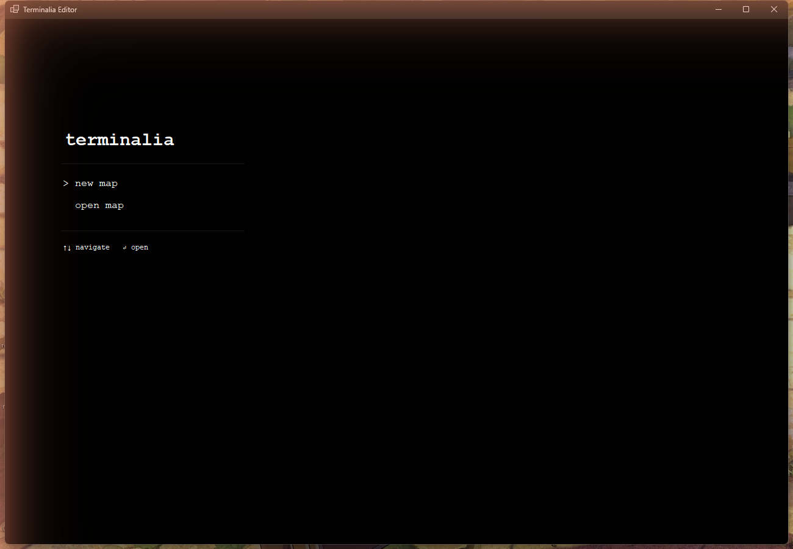

---

## Table of contents

- [Getting started](#getting-started)
- [Architecture at a glance](#architecture-at-a-glance)
- [The start page](#the-start-page)
- [The main editor window](#the-main-editor-window)
- [Command bar reference](#command-bar-reference)
- [Inspector panels](#inspector-panels)
  - [Map](#map-panel)
  - [Tool](#tool-panel)
  - [Palette & Zones](#palette-panel)
  - [Object](#object-panel)
  - [Game](#game-panel)
  - [Run](#run-panel)
- [Tile types](#tile-types)
- [Canvas interaction](#canvas-interaction)
- [Playing the game](#playing-the-game)
- [Exporting a standalone game](#exporting-a-standalone-game)
- [File formats](#file-formats)
- [Project structure](#project-structure)

---

## Getting started

Requirements: **.NET 8 SDK**, Windows (the Editor and exported games are WinForms/`win-x64` only; the Core engine itself is platform-agnostic).

```bash
# Build everything
dotnet build Terminalia.sln -c Debug

# Launch the Editor
dotnet run --project src/Terminalia.Editor/Terminalia.Editor.csproj -c Debug

# Run the unit tests
dotnet test tests/Terminalia.UnitTests/Terminalia.UnitTests.csproj
```

On first launch the Editor opens straight into the **start page** (no project/solution setup required). Maps are read from and written to a `maps/` folder, and the global game configuration lives in `game.json`, both located next to `Terminalia.sln` at the repository root (the Editor walks up from its own executable directory looking for `Terminalia.sln` to find this root).

---

## Architecture at a glance

```
Terminalia.Core                    (zero external dependencies — pure ECS + domain rules)
      ↑
      ├── Terminalia.Rendering.Terminal   (IRenderer adapter for real consoles)
      ├── Terminalia.Input.Console        (IInputProvider adapter for real consoles)
      ├── Terminalia.Assets.Json          (JSON load/save for maps & game config)
      └── Terminalia.TileMapGame          (tile-based game rules: SceneAssembler, EntityRule, TileMapGameSession)
                  ↑
                  └── Terminalia.Runtime.Windows   (hosts the game in a WinForms surface)
                              ↑
                              └── Terminalia.Editor (the app documented below)
```

- **`Terminalia.Core`** never touches `System.Console`, JSON, the file system, or WinForms — it only defines entities, components, systems, and the `Scene` aggregate root.
- **Adapters** (`Rendering.Terminal`, `Input.Console`, `Assets.Json`) implement Core's ports (`IRenderer`, `IInputProvider`, asset loading).
- **`Terminalia.TileMapGame`** turns raw ASCII grids into ECS entities via `EntityRule` (one rule per tile character) and orchestrates play sessions via `TileMapGameSession`.
- **`Terminalia.Runtime.Windows`** embeds the engine inside a WinForms control/window (`WinFormsGameHost`, `WinFormsRenderer`, `WinFormsInputProvider`), used both by the standalone exported game and by the Editor's embedded "Run" player.
- **`Terminalia.Editor`** is pure UI/tooling — it never contains gameplay rules, only calls into the layers above it.

Full architectural rules (LOC limits, naming conventions, folder layout) are documented in [`CLAUDE.md`](CLAUDE.md).

---

## The start page

The first screen shown on launch. It's a minimal terminal-styled menu with two options, navigable by keyboard (arrow keys + Enter) or mouse:

| Option | Behavior |
|---|---|
| **new map** | Opens the *New Map* dialog (see below), then creates a blank map and opens it in a new tab. |
| **open map** | Opens a standard Windows file-picker filtered to `*.json`, rooted at the `maps/` folder. Selecting a map that's already open in a tab switches to that tab instead of opening a duplicate. |

**New Map dialog:**

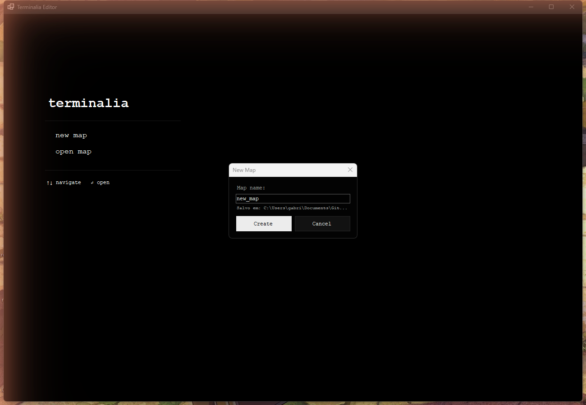

- **Map name** — text field, pre-filled with `new_map`.
- Shows the resolved save path (`maps/` under the repository root).
- **Create** — validates the name is unique (an existing map with the same name is rejected) and creates an 18×7 default map with a border of walls, a player spawn, and a floor interior.
- **Cancel** — returns to the start page.

---

## The main editor window

Once a map is open, the Editor shows its full working layout: a **tab bar** across the top (one tab per open map — click `+` to create another map, click the `×` on a tab to close it), a **vertical command bar** on the left, a **collapsible inspector panel** that slides out from the command bar, and the **map canvas** filling the rest of the window.

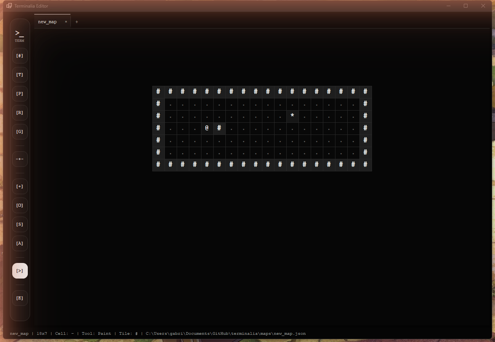

The status bar at the bottom of the window always shows, left to right: the current map name, its dimensions (`WxH`), the grid cell under the cursor, the active tool, the tile currently selected for painting, and the map's file path.

---

## Command bar reference

The command bar is the vertical strip of icon buttons on the far left. Each button either toggles an inspector panel or triggers an immediate action.

| Icon | Name | Action |
|---|---|---|
| `>_` TERM | Terminal | Returns to the start page (closes the current editing session view). |
| `[#]` | Map | Toggles the **Map** panel (name, width, height, camera zoom). |
| `[T]` | Tool | Toggles the **Tool** panel (Paint / Fill mode). |
| `[P]` | Palette | Toggles the **Palette** panel (tile picker + Zones editor). |
| `[R]` | Run | Toggles the **Run** panel (embedded play/stop control). |
| `[G]` | Game | Toggles the **Game** panel (title, start map, menus). |
| `[-+-]` | Select | Switches the canvas tool to Select mode, used to click a tile and inspect/edit its properties in the **Object** panel. |
| `[+]` | New | Opens the *New Map* dialog. |
| `[O]` | Open | Opens the *Open map* file picker. |
| `[S]` | Save | Saves the active map to `maps/{name}.json`. |
| `[A]` | Save As | Saves the active map to a custom path chosen via a file dialog. |
| `[>]` | Run in console | Saves all open maps, then launches the current map in a separate `GameWindow` (the same runtime used by exported games). Arrow keys/WASD move the player; Esc opens the pause menu. |
| `[B]` | Export/Build | Publishes the whole game (all saved maps + `game.json`) as a standalone Windows executable. See [Exporting a standalone game](#exporting-a-standalone-game). |

Only one inspector panel is visible at a time — opening a new one replaces whatever was previously docked.

---

## Inspector panels

### Map panel

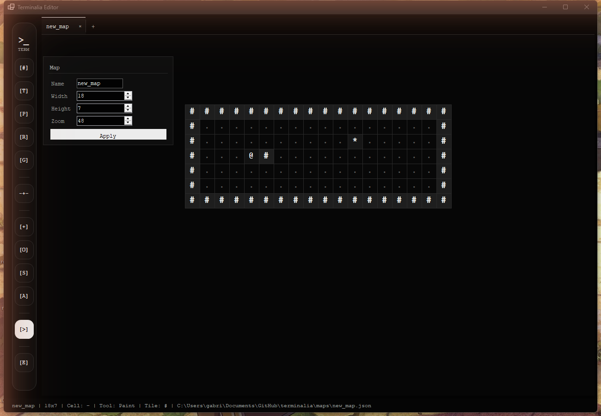

Edits the properties of the currently active map:

| Field | Range | Purpose |
|---|---|---|
| Name | — | Map identifier; also the JSON filename on save. |
| Width | 4 – 80 | Grid width in tiles. |
| Height | 4 – 40 | Grid height in tiles. |
| Zoom | 16 – 128 (steps of 4) | Camera reference cell size used when this map is the active viewport. |

**Apply** commits the changes and resizes/redraws the canvas immediately (existing tiles outside a shrunk grid are discarded).

### Tool panel

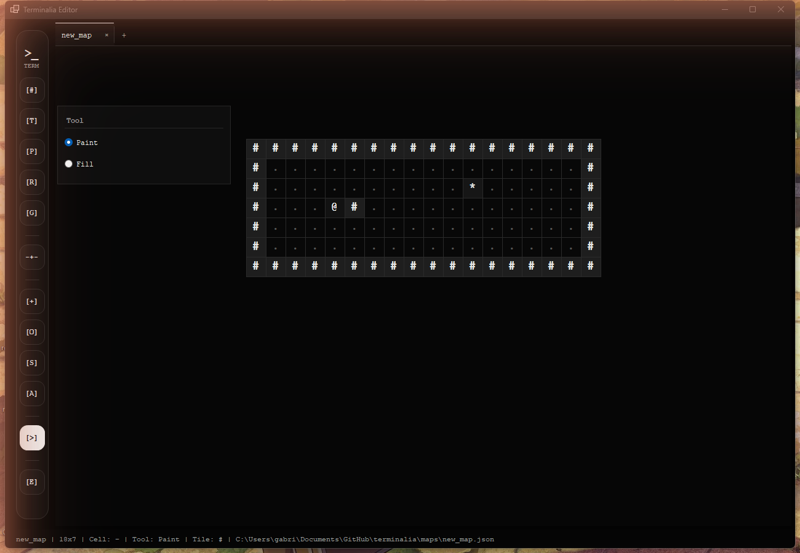

A two-option radio selector controlling how left-click-drag behaves on the canvas:

- **Paint** — stamps the selected palette tile onto each cell the mouse passes over while dragging.
- **Fill** — flood-fills the clicked region: replaces every contiguous cell of the same original tile with the selected tile (classic bucket fill).

### Palette panel

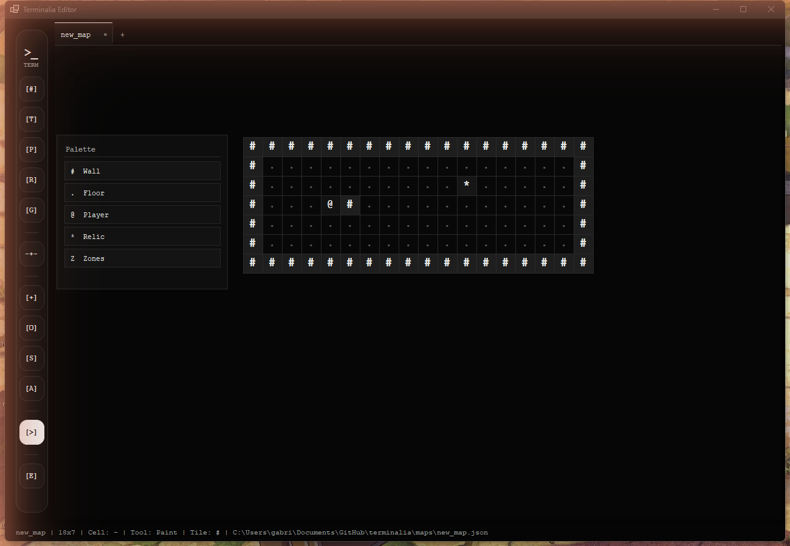

The tile picker. Clicking an entry makes it the "current tile" (shown in the status bar and used by the Paint/Fill tools):

| Entry | Character | Meaning |
|---|---|---|
| Wall | `#` | Solid, blocks movement. |
| Floor | `.` | Passable background tile. |
| Player | `@` | Player spawn point (only one is meaningful per map). |
| Relic | `*` | Optional collectible entity. |
| Zones | — | Switches the panel into the Zones editor (below). |

#### Zones editor

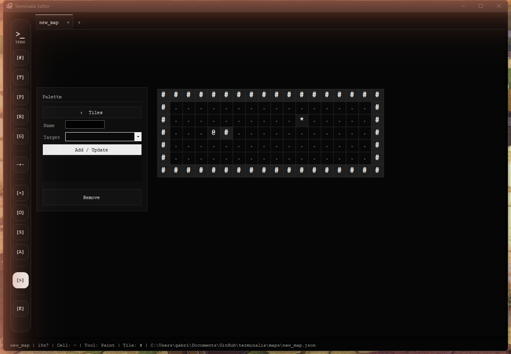

Zones are named regions painted directly onto the map (with the Paint tool while this view is active) that trigger a transition to another map when the player enters them — the mechanism for connecting multiple maps into one game.

| Field | Purpose |
|---|---|
| Name | Zone identifier, e.g. `boss_room`. |
| Target | Combo box listing every map found in `maps/`; the map to load when the player steps into this zone. |
| Add / Update | Creates a new zone definition or updates the selected one. |
| Zone list | All zones defined on the current map; select one to edit or remove. |
| Remove | Deletes the selected zone definition. |
| `‹ Tiles` | Returns to the tile picker. |

### Object panel

Appears automatically when the **Select** tool (`[-+-]`) is active and you click a tile that carries entity data (`@` or `*`). It shows a read-only position plus the entity's tunable properties.

**Player (`@`):**

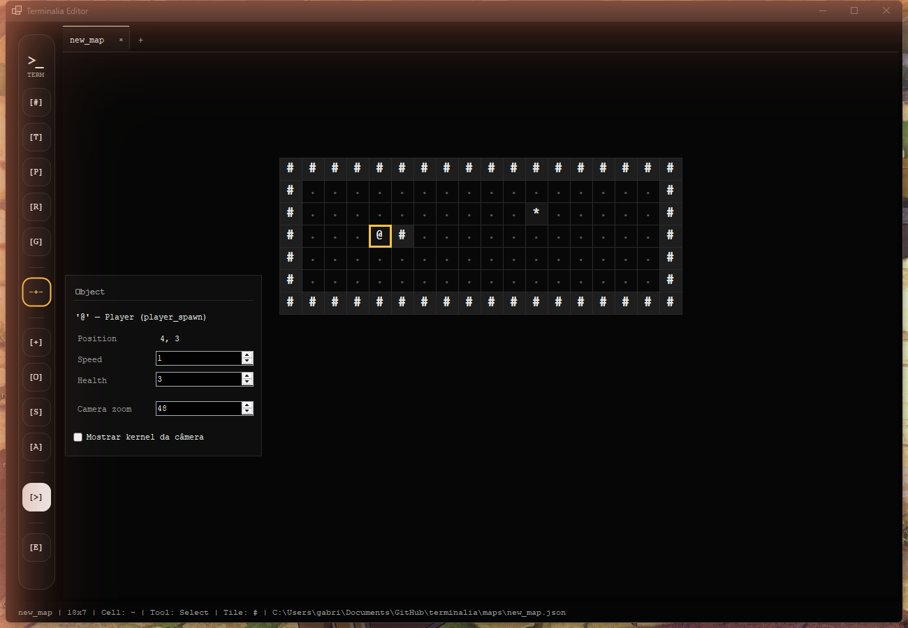

| Field | Range / default | Effect |
|---|---|---|
| Position | read-only | Grid cell (X, Y) of this spawn point. |
| Speed | 1 – 5 (default 1) | Player movement speed used by the runtime. |
| Health | 1 – 999 (default 3) | Player starting hit points. |
| Camera zoom | 16 – 128 | Viewport size while this player instance is active. |
| Mostrar kernel da câmera | checkbox | Draws an overlay rectangle on the canvas showing the camera's viewport bounds centered on this spawn point — useful for judging how much of the map will be visible in-game. |

**Relic (`*`):**

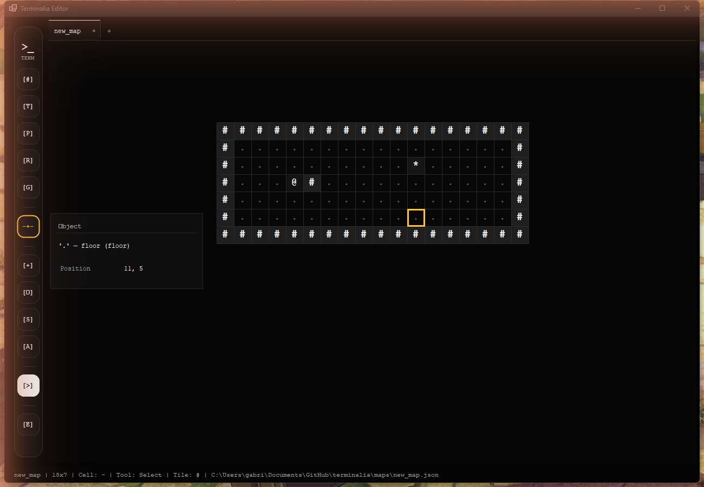

| Field | Default | Effect |
|---|---|---|
| Position | read-only | Grid cell of the relic. |
| Collectible | true | Whether the player can pick it up at all. |
| Disappear on collect | true | If checked, the relic is removed from the scene once collected. |

Clicking the same tile again with the Select tool deselects it and closes the panel.

### Game panel

Configures settings shared by the whole game (not per-map): window title, which map loads first, and the two built-in menus.

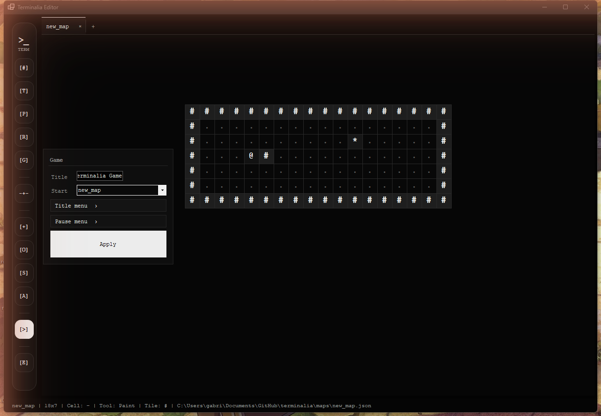

| Field | Purpose |
|---|---|
| Title | Game/window title; also becomes the exported `.exe` filename. |
| Start | Combo box of all maps in `maps/`; the map loaded when the game boots. |
| Title menu › | Opens the title-screen menu editor. |
| Pause menu › | Opens the in-game pause-menu editor. |
| Apply | Persists these settings to `game.json`. |

#### Menu editor (Title / Pause)

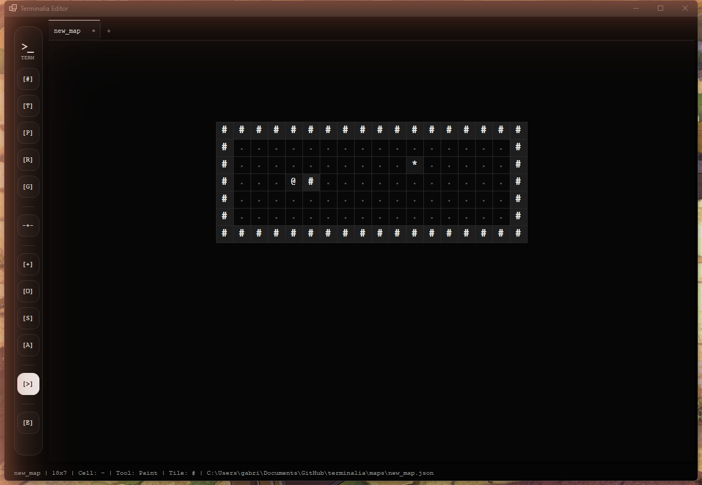

Each menu (title and pause) has a heading and an ordered list of items:

| Field | Purpose |
|---|---|
| Heading | Text shown above the menu (e.g. `TERMINALIA`, `paused`). |
| Label | The menu item's display text. |
| Action | One of the built-in actions: `startGame`, `resumeGame`, `returnToTitle`, `quitGame`. |
| Add / Update | Creates a new item or updates the selected one. |
| Item list | Ordered list of the menu's current items; click one to edit it. |
| Remove | Deletes the selected item. |
| Move up / Move down | Reorders the selected item. |
| `‹ Game` | Returns to the main Game view. |

By default, a new game ships with a title menu (`start` → `startGame`, `quit` → `quitGame`) and a pause menu (`resume` → `resumeGame`, `back to title` → `returnToTitle`, `quit` → `quitGame`).

### Run panel

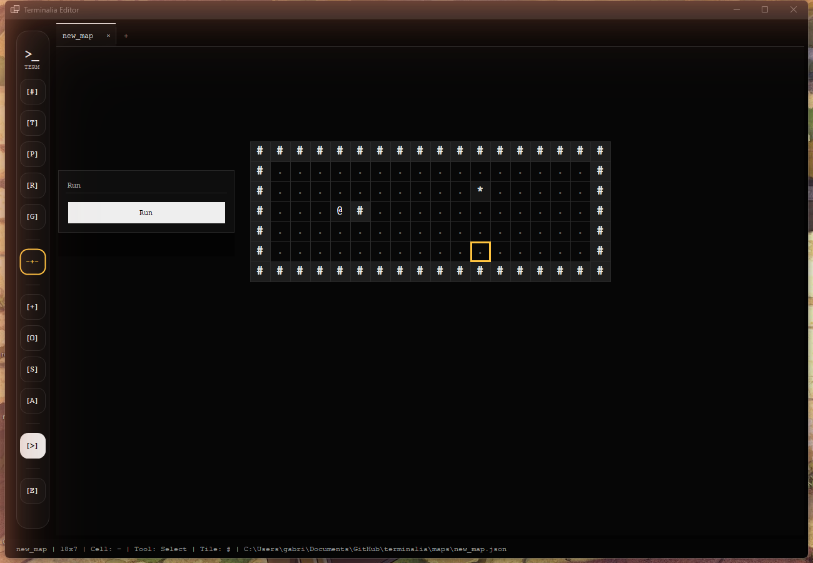

A single button that starts (and, once running, stops) an **embedded** play session of the current map directly inside the Editor window — no separate process, no export needed. Useful for quick iteration while designing a map.

---

## Tile types

Every character in a map's grid is either a plain tile (wall/floor/anything else — purely visual, described via the map's `legend`) or one of two entity tiles with live gameplay behavior:

| Char | Name | Behavior |
|---|---|---|
| `#` | Wall | Solid collider; blocks player movement. |
| `.` | Floor | Passable background. |
| `@` | Player | Spawns the player-controlled entity; carries Speed/Health/Camera-zoom. |
| `*` | Relic | Optional collectible entity; carries Collectible/Disappear-on-collect. |
| *(anything else)* | Custom | Rendered as-is; add a description via the map's Legend so it's documented for other editors. |

---

## Canvas interaction

| Input | Tool | Effect |
|---|---|---|
| Left click + drag | Paint | Stamps the current palette tile on every cell the cursor crosses (no double-stamping the same cell in one stroke). |
| Left click | Fill | Flood-fills the clicked region with the current tile. |
| Left click | Select | Selects the tile, opening its **Object** panel if it's a player/relic. Clicking the same tile again deselects. |
| Left click + drag | Paint (Zones view) | Paints the active zone's region instead of a tile. |
| Right click | any | Picks the tile/zone under the cursor and makes it the active selection (an eyedropper). |
| `Ctrl+S` | any | Saves the active map. |

---

## Playing the game

Two ways to try a map without exporting:

1. **Embedded run** (`[R]` Run panel → **Run**) — plays inside the Editor window itself.
2. **Run in console** (`[>]` in the command bar) — saves all open maps and launches a dedicated `GameWindow`, the exact same host used by an exported build.

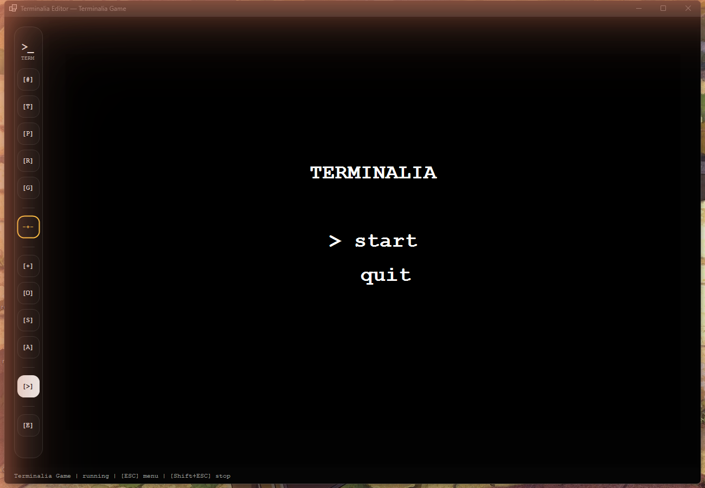

The title menu is keyboard-driven (arrow keys to navigate, Enter to confirm). Selecting **start** loads the configured start map and hands control to the player:

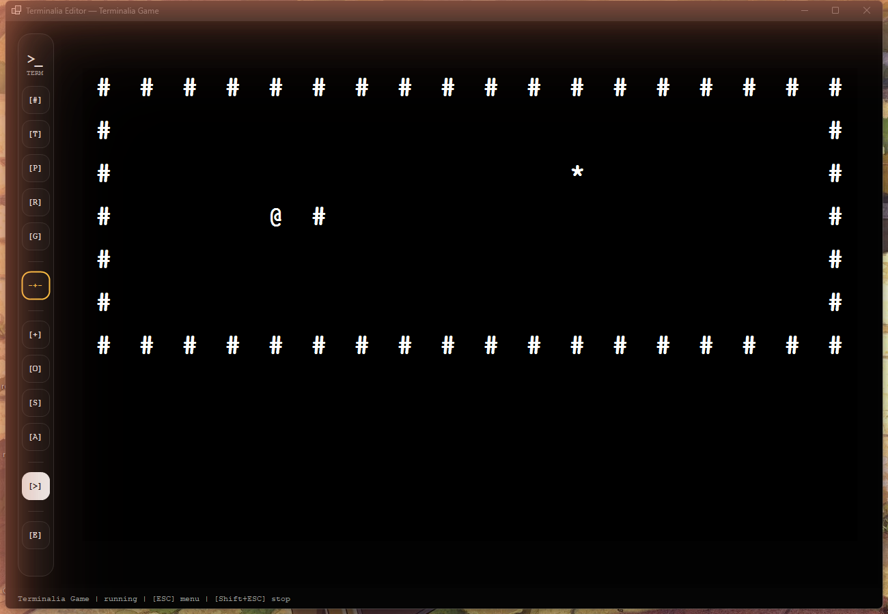

In-game controls:

| Key | Action |
|---|---|
| `↑`/`W` | Move up |
| `↓`/`S` | Move down |
| `←`/`A` | Move left |
| `→`/`D` | Move right |
| `Enter` | Confirm (menus) |
| `Esc` | Open pause menu / back out |
| `Shift+Esc` | Force-stop the embedded session |

---

## Exporting a standalone game

`[B]` in the command bar builds a **self-contained `win-x64` executable** that bundles every saved map plus `game.json`, distributable without the Editor or the .NET SDK installed on the target machine.

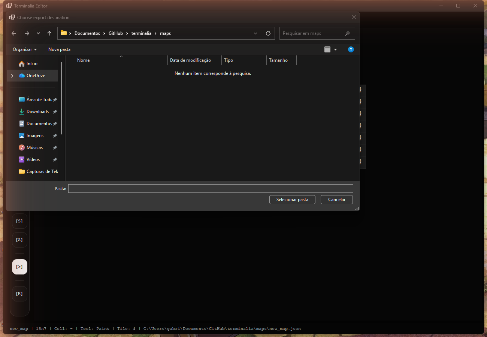

What happens when you export:

1. **Choose destination** — a folder-picker dialog for the output directory.
2. **Build** — runs `dotnet publish` against `Terminalia.Runtime.Windows.csproj` with `-c Release --self-contained -r win-x64`, targeting the chosen output folder.
3. **Bundle assets** — copies every `*.json` file from `maps/` into `{output}/maps/`, plus saves the currently-active map there too.
4. **Validate** — fails with a clear message if the Game panel's configured *Start* map isn't among the exported maps (save it first).
5. **Write config** — copies the game settings to `{output}/game.json`.
6. **Rename executable** — the published `Terminalia.Runtime.Windows.exe` is renamed to `{Game Title}.exe` (invalid filename characters are replaced with `_`).

The result is a flat, runnable folder: `{Game Title}.exe`, `game.json`, and a `maps/` subfolder — just zip and share it.

---

## File formats

### Map file (`maps/{name}.json`)

```json
{
  "name": "new_map",
  "width": 18,
  "height": 7,
  "tiles": [
    "##################",
    "#................#",
    "#..........*.....#",
    "#...@#...........#",
    "#................#",
    "#................#",
    "##################"
  ],
  "legend": {
    "#": "wall",
    ".": "floor",
    "@": "player_spawn",
    "*": "relic"
  },
  "zones": null,
  "cameraZoom": 48,
  "hasZones": false,
  "entities": null
}
```

- `tiles` is a plain array of row strings — the ASCII grid itself.
- `legend` maps each character to a human-readable description, shown nowhere in-game but useful documentation for collaborators.
- `zones`/`hasZones` hold named region definitions and their per-cell grid when the map uses zone transitions.
- `entities` can carry per-tile property overrides (speed, health, collectible, etc.) keyed by position, populated automatically as you edit values in the Object panel.

### Game file (`game.json`, repository root)

```json
{
  "title": "Terminalia Game",
  "startMap": "new_map",
  "titleMenu": {
    "heading": "TERMINALIA",
    "items": [
      { "label": "start", "action": "startGame" },
      { "label": "quit", "action": "quitGame" }
    ]
  },
  "pauseMenu": {
    "heading": "paused",
    "items": [
      { "label": "resume", "action": "resumeGame" },
      { "label": "back to title", "action": "returnToTitle" },
      { "label": "quit", "action": "quitGame" }
    ]
  }
}
```

---

## Project structure

```
terminalia/
├── Terminalia.sln
├── CLAUDE.md              — full architecture & coding-convention guide
├── maps/                  — map JSON files (created by the Editor)
├── game.json              — global game configuration (created by the Editor)
├── src/
│   ├── Terminalia.Core                — ECS, domain rules, ports (zero external deps)
│   ├── Terminalia.Rendering.Terminal  — IRenderer adapter for real consoles
│   ├── Terminalia.Input.Console       — IInputProvider adapter for real consoles
│   ├── Terminalia.Assets.Json         — map/game JSON load & save
│   ├── Terminalia.TileMapGame         — tile-based game rules (SceneAssembler, EntityRule, TileMapGameSession)
│   ├── Terminalia.Runtime.Windows     — WinForms game host (GameWindow, WinFormsRenderer, WinFormsInputProvider)
│   └── Terminalia.Editor              — the editor documented in this README
├── tests/
│   └── Terminalia.UnitTests           — unit tests mirroring the module structure above
└── docs/
    └── screenshots/                   — images used in this README
```

See [`CLAUDE.md`](CLAUDE.md) for the full dependency rule, DDD mapping, ECS conventions, file/LOC limits, and naming rules enforced across the codebase.
